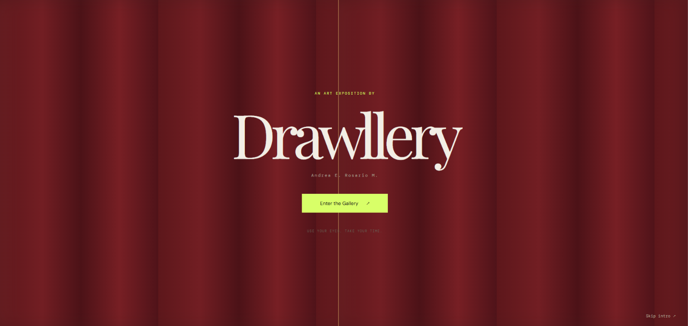
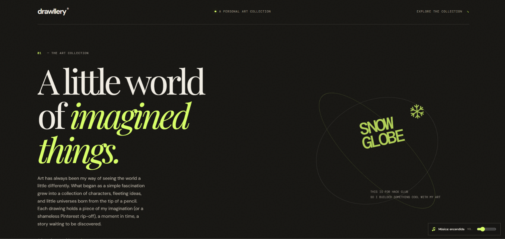
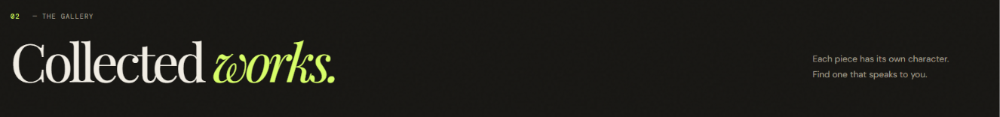

# Drawllery

Drawllery is a personal digital art gallery designed to display illustrations in a visually immersive way. Inspired by museum walls and cinematic presentations, it transforms a simple collection of images into an experience where the artwork takes center stage.

## Preview

# Features

- Visual gallery
- Randomized frames
- Interactive artwork
- Subtle hover effects
- Cinematic introduction
- Personal collection

# What I Learned

While building Drawllery, I explored how to combine HTML, CSS, and JavaScript to create an interactive visual experience. The project gave me the opportunity to experiment with layouts, animations, hover effects, image presentation, and organizing artwork data with JSON.

I also learned how useful Youtube is.

# Challenges

One of the main challenges was finding a balance between making the gallery visually interesting and keeping the focus on the artwork itself. I wanted the experience to feel like walking through an art exhibition while still taking advantage of what a digital gallery can offer.

Another challenge was coordinating the different interactions and visual effects, especially the opening curtain animation, while making sure the experience felt smooth and immersive without becoming overwhelming.

# What's Next?

Drawllery is a personal project that I can continue improving as I experiment with new ideas and add more artwork to the collection.

# Author

Created by **Andrea E. Rosario M.**
